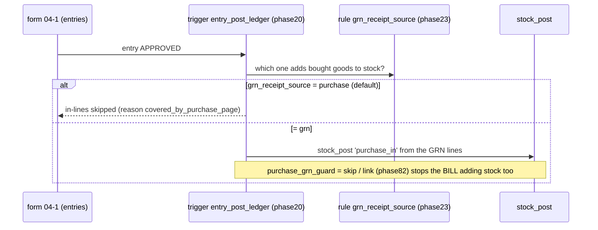
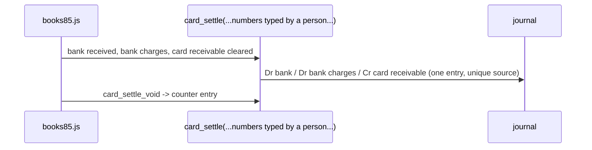
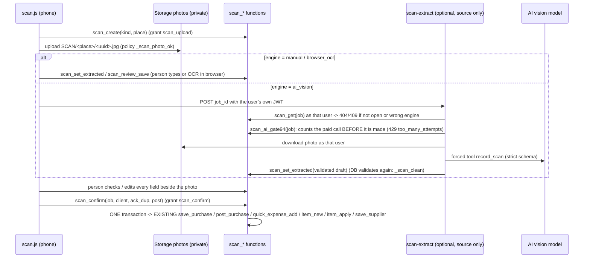

# Data flow

Diagrams are Mermaid `sequenceDiagram` blocks (GitHub renders them). Function and table names are real; each section names the file that defines the step. "GL" = the double-entry journal. Anything not verifiable from the repository is marked **UNVERIFIED**.

Common rules for every flow:
* The browser calls `sb.rpc(...)`; the function checks `can_loc` / `has_grant` / `can_do`, writes, and returns jsonb.
* The journal is **not** written by the business function. `_acct_docs` *derives* the journal proposal from the business tables and `acct_post_pending` posts it once (unique `je_source_uq`). See "Posting step" at the end.
* Stock moves go only through `stock_post` into the immutable `stock_ledger`; `stock_balance` is a trigger-maintained cache.

## 1. Purchase -> stock -> GL  (`phase10.sql post_purchase`, `phase23`, `phase82`)

```mermaid
sequenceDiagram
  participant U as purchase.js
  participant DB as save_purchase / post_purchase
  participant SP as stock_post
  participant L as stock_ledger + stock_balance
  participant A as _acct_docs / acct_post_pending
  U->>DB: save_purchase(draft bill, lines)        (status draft, no stock)
  U->>DB: post_purchase(bill_id, payments)
  DB->>DB: can_loc, has_grant(purchase_entry), lock supplier row, lock_check(bill_date)
  DB->>DB: unit factor -> base qty; price-jump check (purchase_cost_jump_pct) -> yellow exception
  loop each tracked line
    DB->>SP: stock_post(+base qty, 'purchase_in', ref purchase/bill_id, cost = unit_cost x (1 - bill discount share))
    SP->>L: insert ledger row, trigger updates weighted-average avg_cost
  end
  DB->>DB: insert supplier_payments (needs grant supplier_pay), status = posted
  Note over A: later (page open / tick)
  A->>A: source 'purchase': Dr inventory by item type (_acct_purchase_alloc) / Cr payable
  A->>A: source 'supplier_payment': Dr payable / Cr cash|bank|mobile
```
* A re-sent post of an already posted bill returns `dup: true`; it does not post twice.
* A purchase **return** posts stock out at the *current average cost* (`purchase_return`); the difference to the supplier-credit price goes to `purchase_variance` (rule `acct_purchase_variance`, phase 85).
* Void of a posted bill is governed by `purchase_void_guard` off / warn / refuse and `purchase_void_payments` (phase 82).

### 1.1 GRN (form 04-1) vs purchase page - count once

Cross-checks: `receipt_duplicates()`, `grn_pending_report()` (bill-less receipts), flow check `flw_grn_double103` (phase 103: GRN is source + guard off + a bill that added its own stock = warning). Gate for form posting: rule `forms_post_to_ledger` (default OFF) + per-form `forms_ledger_cfg`.

## 2. Production (recipe) -> stock -> GL  (`phase19`, `phase74`, `phase79 production_post`)

```mermaid
sequenceDiagram
  participant U as recipes.js
  participant P as production_post(loc, recipe, batches, client, made_at, note, actual_yield)
  participant SP as stock_post
  participant C as _conv_cost (layer 2)
  participant A as _acct_docs
  U->>P: produce
  P->>P: path_guard('production'), recipe approved?, _recipe_need(recipe, batches, loc)
  P->>P: production_requires_cost = refuse? -> error cost_missing (unknown ingredient cost)
  loop each ingredient / packaging (fixed item order)
    P->>SP: 'issue_out' at weighted average (ref production/run id)
  end
  P->>C: conversion cost: off | recipe rates | monthly pool / NORMAL output
  P->>SP: 'production_in' finished good, unit cost = (material + conversion) / actual output, new batch + expiry (shelf-life rules)
  P->>P: production_runs row (material_cost, conversion_cost, cost_complete, yield variance); yellow flags
  Note over A: later
  A->>A: 'production': Dr finished goods (1310) / Cr raw (1320) + packaging (1330) + overhead_absorbed
```
* If any ingredient cost is unknown (NULL or 0, and not flagged free by `item_cost_free_set`) the finished good has **no cost** and the document waits as `cost_missing` (see TROUBLESHOOTING).
* `production_void(run, note)` (phase 23) reverses the ingredient-out and finished-in ledger rows.
* A direct "production in" without a recipe is `stock_production_in` (phase 10); its cost is typed, with a reason when `production_manual_needs_reason`; booking it is the switch `acct_manual_prod_in103` (default OFF).
* Paper path: form 05-1 is a locked shadow of the run (domain `production`).

## 3. Sale -> stock out -> COGS -> GL  (`record_sale2`, trigger `sales_stock_out`, `_sale_stock_out`)

```mermaid
sequenceDiagram
  participant POS as pos.js
  participant S as record_sale2
  participant TR as trigger sales_stock_out (AFTER INSERT on sales)
  participant SP as stock_post
  participant A as _acct_docs
  POS->>S: record_sale2(lines, payments, p_client uuid ...)
  S->>S: server fixes prices + totals, checks stock/discount/credit limits, same client_id -> returns the old sale
  S->>S: insert sales + sale_payments
  TR->>SP: per tracked line: stock_post(-qty, 'sale_out', ref sale/id, cost = NULL -> current average, neg mode full or soft)
  Note over TR: a sale older than 2 min (or older than offline_sale_max_age) never blocks
  Note over A: later
  A->>A: 'sale': Dr cash|bank|mobile + receivable(+discount) / Cr sales ; Dr COGS / Cr inventory (from ledger unit_cost, rounded per item type)
  A-->>A: flag cogs_missing when a line has no ledger cost > 0 (unless free-cost item)
```
* Void of a sale: `sales_stock_void` posts `sale_void_in` at the original cost; the journal gets the reversing entry.
* Reports use `_cogs_lines72` (ledger cost first, `item_costs` only as flagged fallback) - rule `report_cost_source` (phase 88).

## 4. Sale return  (`sale_return`, phase 12; `sale_returns_summary`, phase 23)

```mermaid
sequenceDiagram
  participant U as salereturn.js
  participant R as sale_return(sale, lines, refund_mode, ...)
  participant SP as stock_post
  participant A as _acct_docs
  U->>R: take goods back (grant sale_return)
  R->>R: _return_check (cannot return more than sold), insert sale_returns
  R->>SP: stock_post(+qty, 'sale_return', ref sale_return/id, cost = ORIGINAL ledger cost, same batch)
  Note over A: later
  A->>A: 'sale_return': Dr sales_returns / Cr receivable (credit) and Cr cash|bank (refund) ; Dr inventory / Cr COGS at original cost
```
Void of a return (`void_sale_return`) posts `reversal` rows. Reports are net of returns (rule `reports_net_of_returns`, ON).

## 5. Landed cost  (`phase97.sql`, rule `landed_cost_mode` default OFF)

```mermaid
sequenceDiagram
  participant U as landed.js (+ landed_q4.js GRN picker)
  participant L as landed_save / landed_approve / landed_post
  participant SP as stock ledger
  participant A as _acct_docs
  U->>L: landed_preview(bills/GRNs, charges, currency+rate, allocation: value|qty|weight|volume|manual|equal)
  U->>L: landed_save (draft) -> landed_approve (grant, or owner) -> landed_post
  L->>SP: per item: pair of rows 'cost_adjust' (on-hand qty OUT at old average, back IN at new average), ref_type 'landed'
  L->>L: landed_cost_alloc + landed_cost_stock (append-only: what was spread where)
  Note over L: the part already sold/consumed is handled by landed_late_mode: split_remaining_and_cogs | post_to_remaining_stock | variance_account
  Note over A: later
  A->>A: 'landed_cost': Dr inventory (stock share) / Dr landed_variance (sold share) / Dr expense or vat_input (not capitalised) ; Cr landed_payable|cash|bank|mobile
  A->>A: 'landed_cost_void': counter entry
```
Cost-right holders only. If phase 89 is pasted again, paste phase 98/103 again (the landed block lives in the merged `_acct_docs`).

## 6. Card settlement  (`phase85.sql card_settle`)


Sales paid by card sit in the card receivable (`pay_card`); nothing is auto-settled. Expense vouchers (10-2) can credit bank/mobile/card through `data.pay_mode` (no value = cash).

## 7. Online order, inbox, Telegram intake  (`phase61`, `phase76`, `phase80`, `phase86`, `phase94`, `phase99`)

```mermaid
sequenceDiagram
  participant X as Customer (web form / Meta / Telegram)
  participant E as Edge function (source only)
  participant B as intake bot login (role intake_bot)
  participant DB as database
  participant P as Person (staff)
  X->>E: web order / Meta message / Telegram update
  E->>E: verify signature or secret (Telegram: TELEGRAM_SECRET_TOKEN checked FIRST, 403 on mismatch)
  E->>B: sign in as intake bot (limited user, NOT service_role)
  alt web form
    B->>DB: web_order_submit(channel, submission uuid, name, mobile, lines, p_proof_hash)
    DB->>DB: rate limit, captcha/proof if configured, price+total computed by server -> online_order_save (idempotent on submission id)
  else Meta / Telegram message
    B->>DB: inbound_message_receive(...) / telegram_message_receive(channel_code, secret_hash, update_id, chat_id, ...)
    DB->>DB: store once per (channel, external id|update_id); failure -> intake_failures list, retried by intake_retry_due()
  end
  P->>DB: inbox_list / inbox_get (phone/address masked by inbox_pii_mode / inbox_pii_guard_on, each view audited)
  P->>DB: person makes the order: online_order_save2 (optional DRAFT if inbox_autodraft_on) -> online_order_draft_verify
  P->>DB: online_order_status new -> confirmed -> packed (stock warning, never blocks) -> delivered
  DB->>DB: delivered calls record_sale2 ONCE (sale_client stored on the order; unique sale_id) -> flow 3
```
* No auto-reply, no AI call and no order is ever created from a message by itself.
* Telegram: the DB stores only the SHA-256 of the channel secret (`telegram_secret_set`) and compares in constant time; a wrong token is logged as a "rejected" line without body.
* Duplicate flags across channels (same customer + item + day): `order_dup_flags`, flag only.

## 8. Offline POS queue replay  (`web/pos.js`, `web/posfail.js`, `phase83`, `phase94`)

```mermaid
sequenceDiagram
  participant POS as pos.js
  participant LS as localStorage bos_pos_queue_<uid>
  participant PF as posfail.js
  participant DB as record_sale_offline (= record_sale2 args)
  POS->>DB: record_sale2(p_client = uuid)
  DB--xPOS: network error
  POS->>LS: queue payload (same p_client)
  Note over POS: when online again
  POS->>PF: replay each queued sale
  PF->>DB: record_sale_offline(payload)  (sets bos.offline_replay = 1)
  alt accepted or client_id already known
    DB-->>POS: sale (same sale returned for the same client id - never a second sale)
  else business refusal (BUSINESS regex in pos.js: insufficient_stock, period_closed, client_id_taken ...)
    PF->>LS: keep as "failed card" bos_pos_failed_<uid>; pos_failed_note tells the owner board
    PF->>DB: manager override pos_replay_override(payload, reason, err) with the ORIGINAL client_id
  end
```
* Stock short on replay: refused unless rule `offline_soft_stock` is ON (then accepted and flagged) or the manager override is used.
* Rule `offline_sale_max_age` (hours, phase 94): a sale older than that no longer skips the stock guard (override still works). Empty = as before.
* A `client_id` already used by *another* user is refused with `client_id_taken`.
* Failed cards can be exported as JSON so nothing is lost if browser storage is cleared. Whether the web client always sets `bos.offline_replay` for ordinary late syncs is **UNVERIFIED** (phase 94 report).
* Form entries have their own client-id outbox (phase 17); stock calls carry `p_client` (unique with `reason` in `stock_ledger`).

## 9. Scan photo -> draft -> confirm  (`phase90`, `phase94`, `supabase/functions/scan-extract`)


There is no auto-confirm. `scan_min_confidence` only warns. Confirm twice = one result (client id). Posting still needs the grants of the called function (e.g. `purchase_entry`). The AI path was never run against a real model (**UNVERIFIED**).

## 10. Posting step (all flows) and backup

```mermaid
sequenceDiagram
  participant UI as accounts page / scheduler tick
  participant AP as acct_post_pending(dry, limit)
  participant D as _acct_docs(start)
  participant J as journal_entries + journal_lines
  UI->>AP: autopost (rule accounting_autopost) or acct_autopost_tick (rule acct_scheduler_on)
  AP->>D: all proposals since accounting_start_date
  D-->>AP: rows (source_type, source_id, lines, flags, waiting)
  AP->>J: insert entry if none for (source_type, source_id)  -- unique je_source_uq
  AP->>J: voided source -> reversing entry; locked period -> skipped; waiting (cost_missing) -> not posted
  AP->>AP: failures kept in acct_post_errors72
```
Nightly backup (`.github/workflows/backup.yml` -> `tools/backup_dump.py`, `tools/backup_photos.py`) reads through the ops bot (`_is_ops('backup')`) and commits to a `backups` branch of the private repo. Restore proof: `tools/restore_drill.py` + `restore_drill_record` (phase 70).
